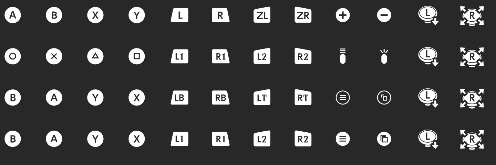
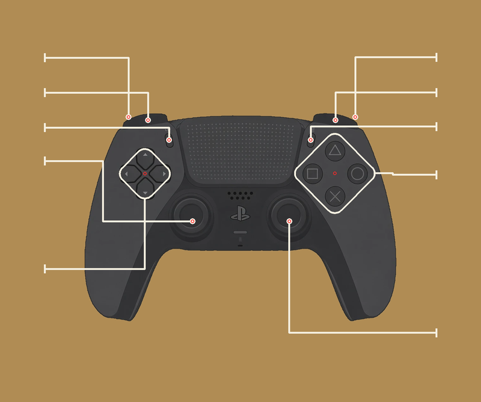
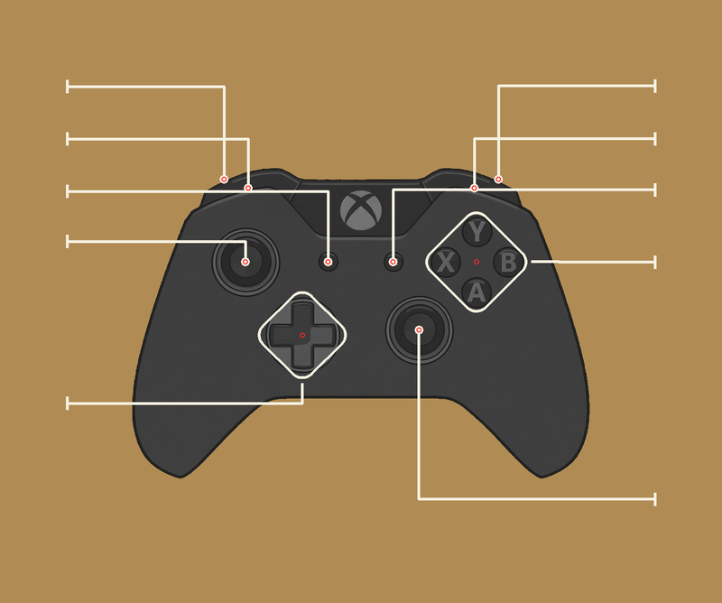
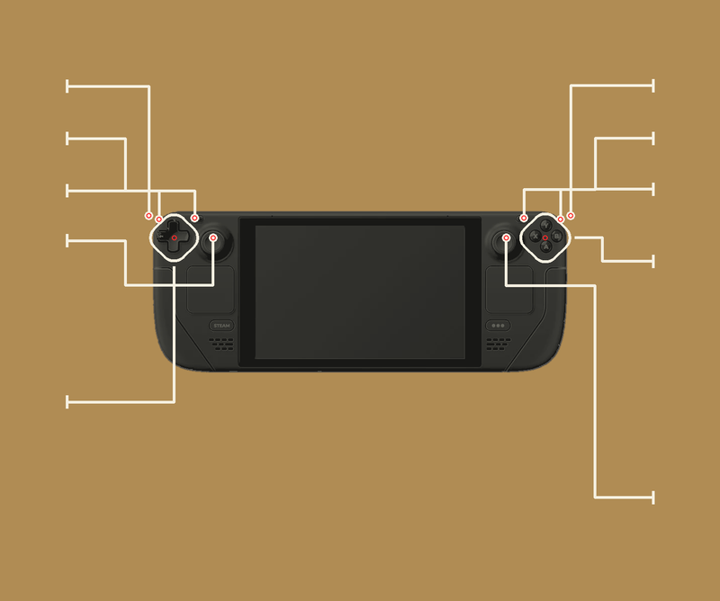
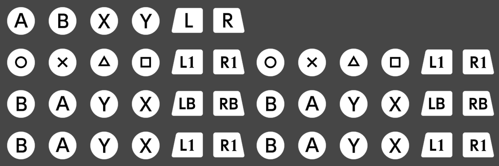

# OOT (Switch 2): PlayStation / Xbox / Steam Deck button icons

RomFS (LayeredFS) mods for *OOT* (Nintendo Switch 2, title ID `0400486024DEC000`, game v2.0.0) that replace:

- the interface's **button icons** (the `External.*.bfotf` glyph font + the `Common.Product.100.*.bntx` textures);
- the **controller drawing** on the "Basic Controls" screen (Pro Controller → DualSense, Xbox controller or Steam Deck), with the label guide lines redrawn for each one.

| Mod | Folder | Download |
|---|---|---|
| PlayStation (DualSense) | `ButtonPrompts-PlayStation` | [Releases](../../releases) → `OoT-ButtonPrompts-PlayStation.zip` |
| Xbox | `ButtonPrompts-Xbox` | [Releases](../../releases) → `OoT-ButtonPrompts-Xbox.zip` |
| Steam Deck | `ButtonPrompts-SteamDeck` | [Releases](../../releases) → `OoT-ButtonPrompts-SteamDeck.zip` |

## Preview

Icons:



"Basic Controls" screen:

| PlayStation | Xbox | Steam Deck |
|---|---|---|
|  |  |  |

Ocarina song sheets (v1.1; row 1 = original, then PlayStation, Xbox, Steam Deck):



Version history: [CHANGELOG.md](CHANGELOG.md).

## Install (Lichii / Eden / yuzu-like)

1. Download the zip of the mod you want from [Releases](../../releases) (or clone this repository).
2. In the emulator, right-click the game → **Open Mod Data Location** (this is the folder `user\load\0400486024DEC000\`).
3. Copy **one** `ButtonPrompts-*` folder there, so it looks like this:
   ```
   user\load\0400486024DEC000\ButtonPrompts-PlayStation\romfs\Font2\...
   user\load\0400486024DEC000\ButtonPrompts-PlayStation\romfs\UI\...
   ```
4. Restart the game. The emulator log should show `LayeredFS layer 'ButtonPrompts-PlayStation'` (or Xbox / SteamDeck).

Install **only one** `ButtonPrompts-*` mod at a time: with more than one, the emulator applies all of them and the last one in alphabetical order wins. Exception: a Lichii build with the **OOT: button icons** setting (Graphics → Advanced) accepts all three installed and lets you pick Switch / PlayStation / Xbox / Steam Deck from the menu.

To uninstall, delete the `ButtonPrompts-*` folder and restart the game.
